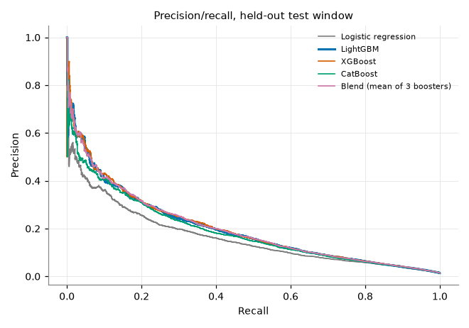
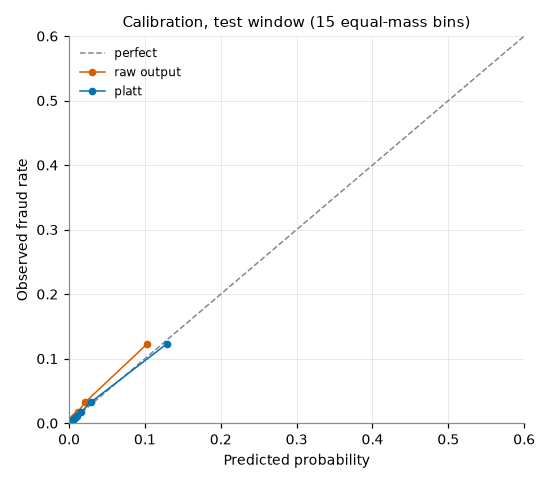
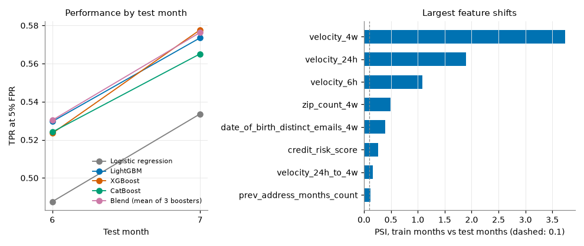
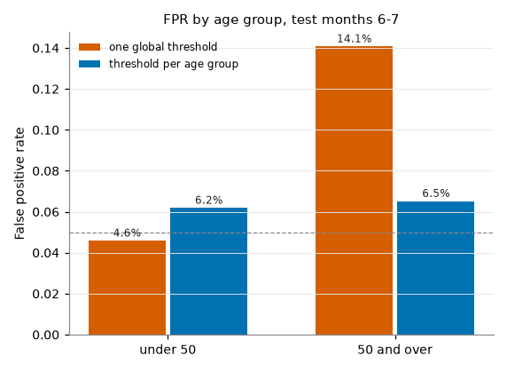
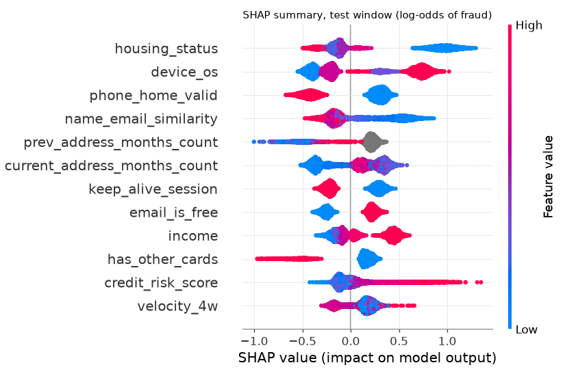

# Explainable fraud screening on the Bank Account Fraud dataset

A pipeline that ranks bank account applications by fraud risk, checks the ranking for drift and for
unequal false positive rates across age groups, and writes a reason code for every alert. It
compares logistic regression, XGBoost, LightGBM and CatBoost (Optuna-tuned, calibrated, with
bootstrap intervals), and runs the same code on the ULB credit-card data as a benchmark.

## Why I built this

I lead data analytics in internal audit. When a team shows me a fraud model I ask four things: how
many alerts can the reviewers actually work, will the model still hold up on next quarter's data,
does it treat customer groups evenly, and what does the reviewer see next to each flag. Most public
fraud examples answer none of them. The ULB credit-card data has anonymised PCA features, no
protected attribute and two days of history, so it cannot answer the last three.

The Bank Account Fraud (BAF) suite can. It has named features, eight months of applications and an
age attribute. This repository is my worked example of the checks I would ask for, run on that
data. The first version of the repository used ULB only; I kept it as the benchmark.

## Data

| Dataset | Use | Size | Source and licence |
|---|---|---|---|
| Bank Account Fraud, Base variant | Primary | 1,000,000 applications, 8 months, 1.1% fraud | Feedzai, Kaggle `sgpjesus/bank-account-fraud-dataset-neurips-2022`, CC BY-NC-SA 4.0 |
| BAF Variants I to V | Fairness and shift sweep | 1,000,000 each | Same release and licence |
| ULB credit-card fraud | Benchmark | 284,807 transactions, 0.17% fraud | Dal Pozzolo et al., via OpenML 1597, ODbL |

Citations:

- Jesus, Pombal, Alves, Cruz, Saleiro, Ribeiro, Gama, Bizarro. Turning the Tables: Biased,
  Imbalanced, Dynamic Tabular Datasets for ML Evaluation. NeurIPS 2022, Datasets and Benchmarks.
- Dal Pozzolo, Caelen, Johnson, Bontempi. Calibrating Probability with Undersampling for Unbalanced
  Classification. IEEE SSCI 2015.

The data is not in the repository. `data/` is gitignored. Download BAF with the Kaggle CLI:

```bash
kaggle datasets download -d sgpjesus/bank-account-fraud-dataset-neurips-2022 -p data/baf --unzip
```

BAF is privacy-preserving synthetic data generated from real bank account-opening records, so
relationships in it are close to the source but not identical to it. It has a month number but no
timestamp within the month, and no amounts. The ULB file on OpenML has lost its `Time` column; I
rebuilt it from row order, which is all the chronological split needs.

## Method

| Step | What I did |
|---|---|
| Split | Months 0 to 4 fit the models. Month 5 is split at random 60/40 into a tuning part (early stopping, Optuna objective) and a calibration part (calibration, blend, model selection, alert thresholds). Months 6 and 7 are the test window and are used once. |
| Features | Sentinel `-1` codes turned into missing values, categoricals with fixed levels (native handling in all three boosters, one-hot for logistic regression), five ratios (credit limit to income, 6h to 24h and 24h to 4w velocity, zip count per branch, address tenure as a share of age). `device_fraud_count` is constant zero and is dropped. `customer_age` is a feature, as in the BAF paper. |
| Models | Logistic regression (quantile-normalised numerics, `C` chosen on the tuning part), XGBoost, LightGBM, CatBoost, and a blend that averages the three boosters' log-odds. |
| Tuning | Optuna TPE, objective TPR at 5% FPR on the tuning part, early stopping on AUC with patience 100. Trials: LightGBM 59, XGBoost 17, CatBoost 30, each family under a wall-clock cap (12, 10 and 20 minutes) on a shared 10-core laptop. Tuning used a row sample of the training months (400k, 100k and 60k rows) and the final models were refit on all 675,666 training rows. Parameters are in `results/best_params_baf.json`. |
| Selection | The booster with the best TPR at 5% FPR on the calibration part is the deployed model, because reason codes need a single tree model. |
| Calibration | Platt or isotonic, chosen by 2-fold cross-fitted Brier score on the calibration part. |
| Metrics | TPR at 5% FPR (BAF's standard metric), PR-AUC, and recall when reviewers work the top 2% of applications. 95% intervals from 500 bootstrap resamples of the 205,011 test rows. |
| Explanations | Native TreeSHAP contributions. Each alert lists its top three features with value, direction and where the value sits against the training data. |

Ranking metrics use the raw model score. Calibrated probabilities are used for probability quality
and for the case file.

## Results on BAF Base

Test window: months 6 and 7, 205,011 applications, 2,878 fraud (1.40%). Square brackets are 95%
bootstrap intervals.

| Model | TPR at 5% FPR | PR-AUC | Recall at top 2% |
|---|---|---|---|
| Logistic regression | 0.504 [0.485, 0.524] | 0.162 [0.151, 0.178] | 0.289 [0.274, 0.306] |
| LightGBM | 0.550 [0.533, 0.570] | 0.198 [0.186, 0.213] | 0.329 [0.313, 0.343] |
| XGBoost | 0.551 [0.534, 0.568] | 0.201 [0.187, 0.218] | 0.335 [0.318, 0.350] |
| CatBoost | 0.541 [0.523, 0.561] | 0.188 [0.174, 0.203] | 0.318 [0.303, 0.334] |
| Blend of the three | 0.555 [0.537, 0.573] | 0.200 [0.186, 0.215] | 0.333 [0.318, 0.349] |

The three boosters are indistinguishable from one another and all beat logistic regression by
about five points of TPR. The blend adds half a point, well inside the interval. On the calibration
part LightGBM scored highest (0.551), so it is the deployed model. Its TPR at 5% FPR on test is
0.550. The `tune` and `cal` windows each hold under a thousand frauds, so a gap of a point or two
in selection is noise too.



Calibration. The raw LightGBM output is already close to calibrated (test ECE 0.0030). Platt
scaling, which the cross-fit picked, brings it to 0.0010; isotonic gives 0.0008. Brier score is
0.0124 for all three.



### Drift

The model is fixed after month 5. Performance by test month, LightGBM:

| Month | Applications | Fraud rate | TPR at 5% FPR | PR-AUC |
|---|---|---|---|---|
| 6 | 108,168 | 1.34% | 0.530 | 0.180 |
| 7 | 96,843 | 1.47% | 0.574 | 0.221 |

The fraud rate rises through the test months and the ranking holds up. What moves is the alert
volume at a fixed threshold. I set the threshold on month 5 so that 5% of legitimate applications
alert. On month 6 it alerts on 6.5% of legitimate applications and on month 7 on 5.7%. A review
team sized from the validation month would see 7.2% and then 6.5% of all applications flagged.

The input distributions move a lot. Population stability index between training months and test
months: `velocity_4w` 3.74, `velocity_24h` 1.89, `velocity_6h` 1.09, `zip_count_4w` 0.49,
`date_of_birth_distinct_emails_4w` 0.40, `credit_risk_score` 0.26 (0.25 is the usual line for a
large shift).

I also trained the same LightGBM configuration with a random split of the same sizes. TPR at 5% FPR
is 0.556 against 0.550 for the temporal split, so on Base the temporal split does not cost ranking
quality. PR-AUC differs (0.166 random, 0.198 temporal) because the test fraud rate differs (1.1%
against 1.4%), so PR-AUC is not comparable across the two.



### Fairness: predictive equality across age groups

Predictive equality asks for equal false positive rates across groups, as in the BAF paper. Groups
are `customer_age` 50 and over (16.5% of test applications) against under 50. The older group
has the higher fraud rate (2.9% against 1.1% in the test months; 2.2% against 0.7% in training),
so a single score threshold alerts on far more of its legitimate applicants.

| Threshold rule (set on month 5) | FPR under 50 | FPR 50 and over | FPR ratio [95% CI] | Overall FPR | Overall TPR [95% CI] |
|---|---|---|---|---|---|
| One global threshold | 4.6% | 14.1% | 3.07 [2.97, 3.17] | 6.1% | 0.593 [0.576, 0.610] |
| One threshold per age group | 6.2% | 6.5% | 1.05 [1.01, 1.10] | 6.2% | 0.567 [0.550, 0.584] |

Mitigation: group-specific thresholds, each chosen so the group's FPR is 5% on month 5. The test
FPRs land above 5% in both groups for the drift reason described above, but they land together.

The trade-off is real. At the same overall FPR the overall TPR falls by 2.6 points. The group
recalls move in opposite directions: under-50 TPR rises from 0.514 to 0.570 and 50-and-over TPR
falls from 0.743 to 0.562. The global threshold catches more fraud among older applicants largely
because it holds them to a much looser standard. Whether that is acceptable is a policy decision,
and I would put the table in front of the risk owner rather than pick for them.

Removing `customer_age` and the age-derived address ratio does not fix it. TPR at 5% FPR is 0.553
(0.550 with age), and under one global threshold the FPR ratio only drops from 3.07 to 2.29.
So other features carry part of the age signal. Group thresholds on the model without age give ratio 1.07
and TPR 0.563, about the same as with age.

Using age in a threshold rule is itself a design choice with legal implications that depend on the
jurisdiction. I report it because it is what the BAF paper evaluates.



### The other five BAF variants

One fixed LightGBM configuration (the Base-tuned one), retrained on each variant with the same
temporal split. Variants differ in group sizes and group fraud rates, shown in the second and
third columns, and in how well the model separates the classes.

| Variant | Share 50+ | Fraud rate 50+ / under 50 | TPR at 5% FPR | FPR ratio, global | FPR ratio, per group | Overall TPR, global / per group |
|---|---|---|---|---|---|---|
| Base | 18.3% | 2.34% / 0.83% | 0.550 | 3.07 | 1.05 | 0.593 / 0.567 |
| I | 11.1% | 1.22% / 1.09% | 0.531 | 1.24 | 1.13 | 0.564 / 0.566 |
| II | 50.6% | 1.82% / 0.36% | 0.556 | 6.62 | 1.02 | 0.596 / 0.536 |
| III | 50.6% | 1.12% / 1.09% | 0.760 | 5.03 | 1.16 | 0.779 / 0.741 |
| IV | 50.6% | 1.66% / 0.54% | 0.445 | 6.38 | 1.02 | 0.480 / 0.534 |
| V | 50.6% | 1.12% / 1.09% | 0.367 | 4.90 | 1.12 | 0.391 / 0.438 |

The FPR gap does not need a fraud-rate gap: Variants III and V have equal fraud rates and still show
a ratio near 5 under the global threshold, so the groups differ in how separable they are, not
only in prevalence. In IV and V, per-group thresholds raise overall TPR as well. In Variants II to V the month 5
threshold lets through about 2% of under-50 legitimate cases and about 10% of older ones on the
test months, so the global threshold transfers badly there and per-group thresholds fix more than
the gap.

## Reason codes

`reports/flagged_cases.md` holds the 15 highest-scoring alerts from the test months with their
reasons. At the month-5 threshold LightGBM raised 14,094 alerts on the test window, 1,706 of them
fraud (12.1% precision). The global SHAP picture is led by `housing_status`, `device_os`,
`phone_home_valid`, `name_email_similarity` and `prev_address_months_count`.

A case reads like this:

```
Case 1: calibrated probability 0.90
  1. housing_status = BA (16% of training rows) raises the score (+1.05 log-odds)
  2. proposed_credit_limit = 2000 (training percentile 99) raises the score (+0.84 log-odds)
  3. device_os = windows (27% of training rows) raises the score (+0.72 log-odds)
```

A reviewer can check each of those fields against the application. The checklist under every
case lists the follow-up steps.



## ULB 2013 benchmark: what changes

Same code, same models, same metrics, with a 70/15/15 chronological split. The tuning objective is
PR-AUC here, because TPR at 5% FPR is 1.0 on the 34 frauds in the tuning window and gives Optuna
nothing to rank. The review budget is the top 0.5% of transactions. Test window: 42,722
transactions, 52 frauds.

| Model | TPR at 5% FPR | PR-AUC | Recall at top 0.5% |
|---|---|---|---|
| Logistic regression | 0.885 [0.787, 0.964] | 0.691 [0.532, 0.829] | 0.788 [0.667, 0.893] |
| LightGBM | 0.865 [0.776, 0.958] | 0.741 [0.629, 0.858] | 0.788 [0.678, 0.903] |
| XGBoost | 0.865 [0.755, 0.956] | 0.760 [0.633, 0.862] | 0.808 [0.694, 0.911] |
| CatBoost | 0.846 [0.740, 0.935] | 0.745 [0.621, 0.853] | 0.750 [0.634, 0.864] |
| Blend of the three | 0.904 [0.812, 0.977] | 0.758 [0.634, 0.865] | 0.788 [0.672, 0.900] |

What the comparison shows:

- ULB cannot rank the models. Every interval overlaps every other, and logistic regression is
  within noise of the boosters. With 52 test frauds one case moves recall by two points. On BAF
  the intervals are tight enough to separate logistic regression from the boosters.
- Drift is invisible on ULB and large on BAF. The ULB test window is about seven hours. On BAF,
  the same model needs a different threshold by month and the velocity features have shifted far
  beyond the usual PSI limits. A random split on ULB gives TPR 0.944 against 0.865 for the
  chronological split, but with 52 frauds that difference is within the intervals.
- Reason codes on ULB name `V14` or `V10`, which a reviewer cannot map to anything. On BAF they
  name `housing_status` or `proposed_credit_limit`, and the reviewer can act on them. Explainability
  only adds value when the features mean something.
- Fairness cannot be tested on ULB at all because there is no protected attribute. On BAF the
  default threshold produces a threefold FPR gap between age groups, and the fix costs recall.
- Calibration matters more on ULB. The raw output of the deployed XGBoost has ECE 0.027 against
  0.003 for the BAF LightGBM, and the tuned class weight differs (6.7 against 1.05).

## Reproduce

```bash
python -m venv .venv && source .venv/bin/activate      # Python 3.10+, results use 3.12
pip install -e ".[dev]"
kaggle datasets download -d sgpjesus/bank-account-fraud-dataset-neurips-2022 -p data/baf --unzip

fraud-xai train --dataset baf --artifacts artifacts/baf     # tuning plus evaluation
fraud-xai train --dataset ulb --artifacts artifacts/ulb --trials 30 30 20
fraud-xai variants --params artifacts/baf/best_params.json  # six BAF variants
fraud-xai report --artifacts artifacts/baf                  # figures and case file
pytest && ruff check . && ruff format --check .
```

Tuning for BAF took about 30 minutes of wall-clock time and the evaluation about 11 more, on a
laptop shared with other jobs. `--reuse-params results/best_params_baf.json` skips tuning for any
family listed in the file. The numbers above come from `results/metrics_baf.json`,
`results/metrics_ulb.json` and `results/variants.json`. Seeds are fixed, but LightGBM, XGBoost and
CatBoost are multi-threaded, so a rerun can differ in the third decimal.

CI runs the tests on a small synthetic frame with the BAF schema and downloads nothing.

## Layout

```
src/fraud_xai/   data.py (BAF, ULB, fixtures)   models.py (families, Optuna)   metrics.py
                 pipeline.py (train, evaluate)  explain.py (reason codes)    report.py   cli.py
tests/           fixture-based tests of the split, features, metrics, fairness and report
results/         metrics, best parameters and the variant sweep from the runs above
reports/         flagged_cases.md
docs/            figures
```

## Licence

Code: MIT. The BAF data is CC BY-NC-SA 4.0 and is not redistributed here, so anything built on it
stays non-commercial and share-alike. The ULB data is under ODbL.
